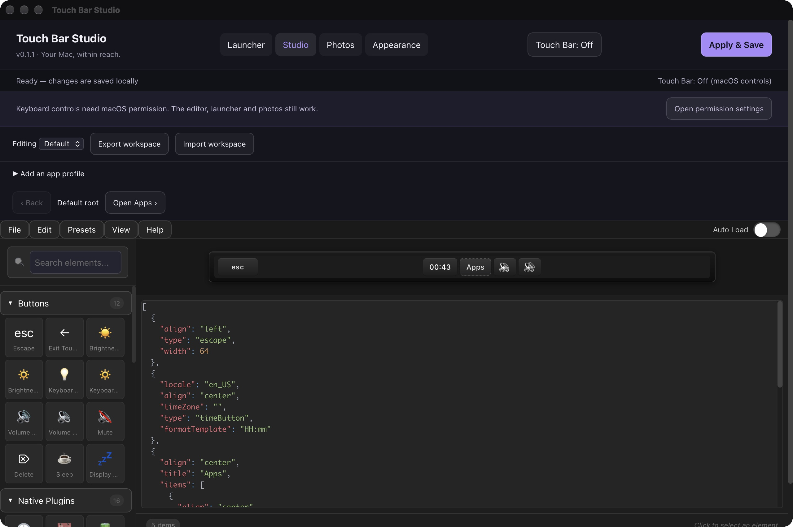

# Touch Bar Studio — first working version

Open **Touch Bar Studio.app** in the folder above this repository. It is built locally from source and contains the web editor and native MTMR runtime; no browser server is required.

## Use it

- **On/off:** click **Touch Bar: On/Off** beside Apply & Save, or choose **Turn Custom Touch Bar Off/On** from the app menu or menu bar icon. Off dismisses the custom bar and restores macOS controls. The choice takes effect immediately and survives restart; saving layouts does not turn it back on. The launcher and editor remain available.

- **Exact placement:** choose **Precise placement**, drag controls horizontally or type **X position** and **Width** in Properties. The 1085-unit canvas scales to the available bar width, with Back reserved on submenu screens. The editor warns about overlaps. Apply & Save activates the placement; automatic alignment remains available.
- **Studio:** drag or click controls from the palette. Choose **Apply & Save** to activate the full workspace on the Touch Bar.
- **App profiles:** expand **Add an app profile**, choose an installed app, then **Duplicate Default**. Select the new profile from the Editing picker. Its layout completely replaces Default while that bundle ID is frontmost. Disabled and unmatched apps fall back to Default.
- **Submenus:** add a Group and give it a title. Use **Open [name]** to edit its children. Groups can contain more groups. Drag onto a group to move a control into it; the move selector can move selected controls back to the root. The physical runtime adds **‹ Back** at every depth. Editing the preview does not change the physical layout until Apply & Save.
- **Launcher:** add apps and folders, then edit names, colors, visibility and order under **Edit tiles**. Apply & Save keeps the launcher across restarts.
- **Compact launcher:** use the menu bar Launcher item or Control + Option + Space. Appearance offers Command + Shift + Space as an alternative; Apply & Save activates the choice. Other apps or system shortcuts can conflict.
- **Photos:** choose a folder, adjust thumbnail size, filter by filename, extension, orientation, minimum dimensions and modification date, and click an image to inspect dimensions. Folder browsing is one level deep. Original images are never written or deleted.
- **Finder:** the app declares **Open in Photo Workspace** as a macOS Service, and accepts photos/folders through Finder's Open With menu. macOS may require enabling the Service in Keyboard → Keyboard Shortcuts → Services. A dedicated Finder Quick Action extension and resize-copy action are future work.
- **Appearance:** preview colors, a still background image and optional subtle motion. The system Reduced Motion setting overrides decorative animation. No video backgrounds or system appearance patches.

The editor keeps local drafts. Apply & Save writes the actual runtime workspace. The native save is atomic and keeps the previous successful workspace as a backup. Script controls remain in imported/exported JSON, but custom AppleScript, shell and swipe scripts are disabled in this build. Unknown JSON fields and unknown item types survive editor import/export; native Apply reports an error for types it cannot decode.

Permission is needed for synthetic keyboard/media controls. Version 0.1.1 checks silently and never requests it on launch. Use **Open permission settings** in the app, or **Keyboard Control Permission…** in its menu, then grant access yourself under Privacy & Security → Device Control and Data Access (called Accessibility on earlier macOS versions). If an old grant does not match the latest ad-hoc build, remove the old Touch Bar Studio entry and add the current `Touch Bar Studio.app` from the folder above this repository. Quit and reopen the app after granting.



Local ad-hoc signatures identify a specific build; rebuilding can invalidate the old grant. To retain an identity across updates, supply an existing signing certificate using `STUDIO_SIGNING_IDENTITY='certificate name' ./build-local.sh`. The build does not create certificates, change certificate trust or modify macOS permission records. No Full Disk Access or changes to system protections are required. Touch Bar presentation retains the upstream private framework APIs, which Apple can change; physical display/navigation must still be checked on the Mac's actual Touch Bar.

## Storage and reset

Saved workspace: `~/Library/Application Support/TouchBarStudio/workspace.json`.
Backup: `workspace.previous.json` in the same folder.

Export the workspace before experimenting. To reset: export a backup, use the JSON panel to import an empty item array `[]` into each profile, remove extra profiles and launcher tiles, then Apply & Save. For a complete storage reset, quit and rename both the TouchBarStudio support folder and `~/Library/WebKit/nz.caylum.touchbarstudio` (the app's web editor drafts), then restart. Photos and legacy MTMR presets are separate and remain untouched. Login at start is optional in the upstream menu; it is not enabled by this build.

## Build and check

The native build uses the macOS Command Line Tools, so full Xcode is not required. JavaScript dependencies are pinned by package-lock.json; install with `npm ci --ignore-scripts` if needed. Node can come from PATH or the bundled Codex runtime.

From this directory, after closing the app:

```sh
./build-local.sh
./../'Touch Bar Studio.app'/Contents/MacOS/TouchBarStudio --self-test
```

With Node on PATH:

```sh
node local-build/check-state.mjs
```

Generated app: `../Touch Bar Studio.app`. Compiler diagnostics: `local-build/compiler.log`. Upstream code produces deprecation warnings against the macOS 27 SDK.

## Upstream and source review

Based on https://github.com/josmanvis/mtmr-designer and its bundled MTMR runtime. The original editor, palette, property controls, presets, JSON panel and undo/redo are retained. Upstream's source commit is recorded by this checkout's Git history. No upstream DMG, bundled Sparkle binary or downloaded application executable is used. Automatic upstream binary updates are disabled.

Preserve the original source notices: `mtmr-src/LICENSE` contains the MTMR MIT license; individual bridge files also contain other notices, including GPL and LaunchAtLogin licensing. This is a local development build, not a reviewed redistribution package.

## Verification

Automated checks cover recursive editing, moves and cycle prevention, undo/redo, full profile replacement, native app matching and disabled/unmatched fallback, recursive runtime decoding, script filtering, unknown-field round trips and JSON parsing. Native UI checks are recorded in `VERIFICATION.md`. A successful build or native decode is not proof of physical Touch Bar behavior.
