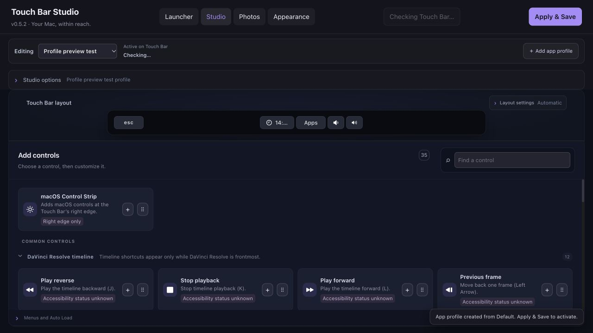
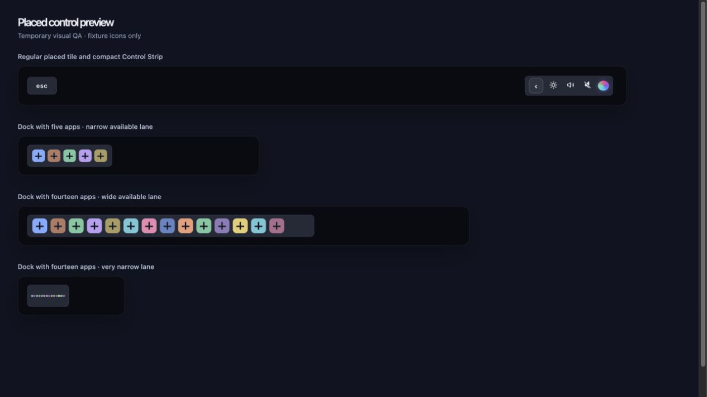
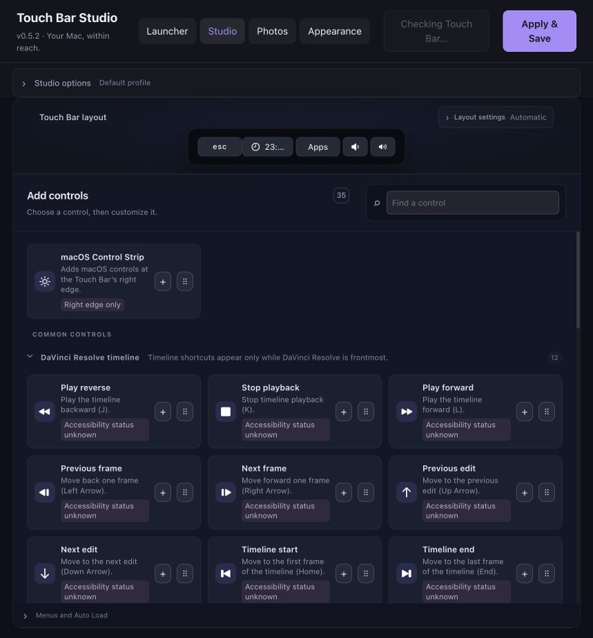
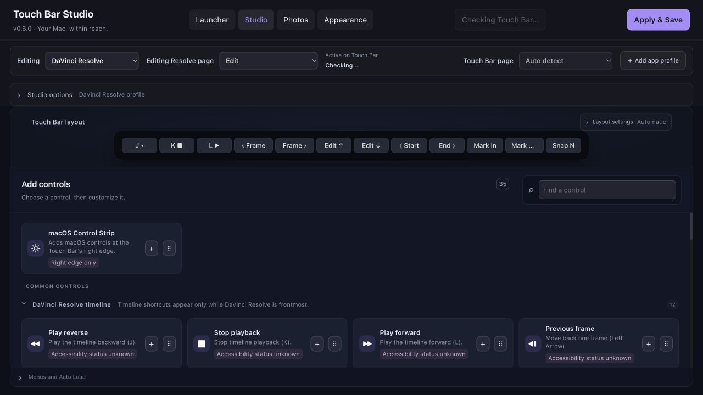

# Touch Bar Studio

Touch Bar Studio is a macOS app for designing Touch Bar layouts, switching layouts by app, launching apps and folders, and browsing photos. It builds on [MTMR Designer](https://github.com/josmanvis/mtmr-designer) and its bundled [MTMR](https://github.com/Toxblh/MTMR) runtime; upstream history and source notices are retained.

The current source version is **0.6.0**. This is the repository version, not a published GitHub release. See the [verification record](VERIFICATION.md) for checks and known limits.

## Edit and apply profiles

The **Editing** selector stays above the preview so it is clear which profile you are changing. **Add app profile** starts a new profile as a copy of Default and selects it for editing. This selection controls the editor; **Active on Touch Bar** separately reports the layout currently in use. Use **Apply & Save** to activate and save your edits. The Touch Bar On/Off control takes effect immediately.



Studio provides an icon-based control library, a Touch Bar preview, precise placement, nested groups, presets, JSON import/export, and undo/redo. Secondary options start collapsed to leave more room for the preview and controls. Drag a control or use its **+** action to add it. Open **Precise placement** in Layout settings to set a control's leading-edge X position and width on the 1085-unit design canvas. The runtime scales that canvas to the area macOS provides; overlapping controls show a warning.

The **Dock** preview uses the current Dock app list and icons. It expands when room is available, then reduces icon and gap sizes to fit all apps without internal scrolling. Other controls keep their positions. Date and CPU controls use minimum content-fit widths in the preview and native layout; saved positions and widths are not changed by this behavior. The native macOS Control Strip is a separate tile at the preview's right edge. It is controlled by **Keep macOS Control Strip** and is not a saved profile item. The screenshots show the preview with the Control Strip collapsed and expanded: [collapsed](docs/screenshots/control-strip-preview-collapsed.jpg), [expanded](docs/screenshots/control-strip-preview-expanded.jpg).



## DaVinci Resolve timeline controls

The palette includes 12 Resolve-specific timeline buttons for J/K/L playback, frame and edit navigation, timeline start and end, In and Out points, and snapping. Each is a static button with an editable shortcut and a distinct macOS symbol. They appear on the native bar only while DaVinci Resolve is active.



Shortcut defaults and app filtering are documented in [Resolve timeline controls](docs/RESOLVE-TIMELINE-CONTROLS.md). The palette, shortcut editing, serialization, native decoding, and permission-state checks passed. The final installed binary has Accessibility access and Auto mode followed Edit → Color → Fairlight → Edit; Fairlight used the profile fallback. Manual Color selection followed by returning to Auto was verified on the immediately preceding 0.6.0 build. Physical Touch Bar behavior and shortcut delivery remain untested.

## Resolve page layouts

Create a Resolve app profile with **＋ Resolve page layouts**. It starts from a copy of Default and adds separate Edit and Color layouts; existing profiles and layouts are preserved. Edit starts with the 12 timeline controls above, and Color starts with eight shortcuts verified against Blackmagic's Resolve manual. Other Resolve pages are listed too: until you create a layout for one, it uses that profile's fallback layout. Editing a page never changes the fallback or another page.

When Resolve is frontmost, Touch Bar Studio reads the selected page from the standard window's Accessibility controls. Page detection requires Accessibility access; if it is unavailable or ambiguous, the app uses the profile fallback. Choose **Auto detect** or a manual page in the Studio toolbar, or use the page picker on the Touch Bar. The editor's **Editing Resolve page** selector only chooses which layout you edit; it does not switch Resolve itself. The final installed binary followed Edit → Color → Fairlight → Edit in Auto mode, using the profile fallback for Fairlight. Manual Color selection followed by returning to Auto was verified on the immediately preceding 0.6.0 build. Physical Touch Bar page switching and shortcut delivery have not been tested.




## Other features

- Default and app-specific profiles matched by bundle identifier, with recursive submenus and Back navigation.
- App and folder launchers, including a compact launcher shortcut.
- Appearance options for theme colors, still backgrounds, and reduced-motion-aware fades.
- A photo browser with filename, type, dimensions, orientation, and date filters, plus a basic metadata inspector. Originals stay unchanged.
- Finder **Open With** support and a macOS Service declaration.

## Build from source

Build locally on macOS with Apple's Command Line Tools, Node.js 22.12 or newer, npm, and Python 3. Full Xcode is not required. Install dependencies and build:

```sh
git clone https://github.com/Caylum-Hudson/touch-bar-studio.git
cd touch-bar-studio
npm ci --ignore-scripts
./build-local.sh
```

The app is written to `../Touch Bar Studio.app`. Close a running copy before rebuilding. The build script runs frontend checks, creates the Vite production build, builds the native app, and runs its self-tests. The app is locally ad-hoc signed and is not notarized. The manual GitHub Actions build does not publish releases.

See [first-run instructions](FIRST-RUN.md) for permissions, saved configuration, profiles, and launchers. The [control runtime audit](docs/CONTROL-RUNTIME-AUDIT.md) describes palette controls and their requirements. The [verification record](VERIFICATION.md) distinguishes automated and editor checks from physical hardware testing.

## Current limits

The 0.5.2 installed build passed its frontend/native checks and strict code-signature verification. Version 0.6.0 passed the focused frontend reducer/serialization checks, Vite build, installed native self-tests, and strict code-signature verification. Browser QA covered page templates, the editing selector, and saved layout separation; the installed app also passed live Auto and manual Resolve page checks. The installed build distinguishes its generated picker from user groups titled Auto or Manual. Physical Touch Bar pixels or taps and keyboard/media action delivery on hardware remain unverified. The preview is a design surface; dynamic values shown there can be illustrative. MTMR uses private macOS Touch Bar APIs that Apple may change. Script and swipe controls are import/export only, and Sleep controls are unavailable.

## Attribution and licensing

The original MTMR Designer documentation is preserved in [docs/UPSTREAM-README.md](docs/UPSTREAM-README.md). The bundled MTMR license is in [mtmr-src/LICENSE](mtmr-src/LICENSE). Preserve file-level notices as well: inherited bridge code includes other license terms, including GPL and LaunchAtLogin notices. This repository is not a separately reviewed binary redistribution package.
