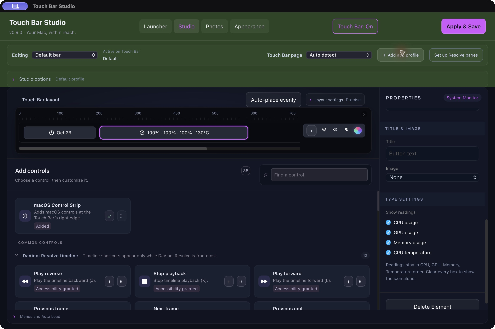
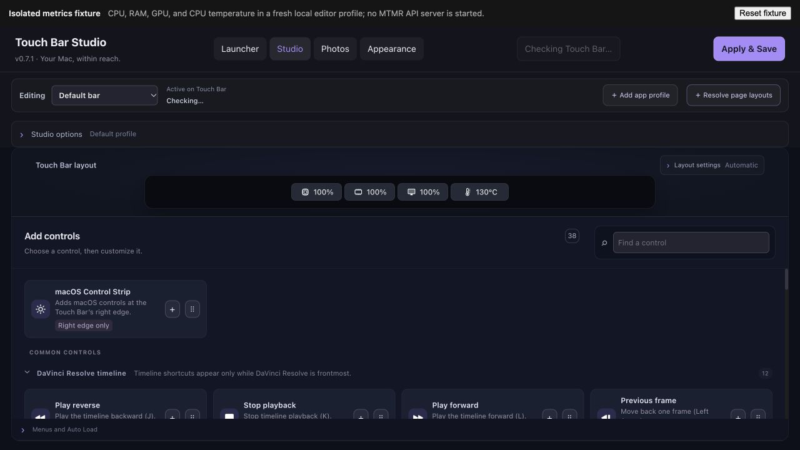

# Touch Bar Studio

Touch Bar Studio is a macOS app for designing Touch Bar layouts, switching layouts by app, launching apps and folders, and browsing photos. It builds on [MTMR Designer](https://github.com/josmanvis/mtmr-designer) and its bundled [MTMR](https://github.com/Toxblh/MTMR) runtime; upstream history and source notices are retained.

The current source version is **0.9.3**. This is the repository version, not a published GitHub release. See the [verification record](VERIFICATION.md) for checks and known limits.

## Edit and apply profiles

The **Editing** selector stays above the preview so it is clear which profile you are changing. **Add app profile** starts a new profile as a copy of Default and selects it for editing. This selection controls the editor; **Active on Touch Bar** separately reports the layout currently in use. Use **Apply & Save** to activate and save your edits. The Touch Bar On/Off control takes effect immediately.


Studio provides an icon-based control library, a Touch Bar preview, precise placement, nested groups, presets, JSON import/export, and undo/redo. Secondary options start collapsed to leave more room for the preview and controls. Drag a control or use its **+** action to add it. Open **Precise placement** in Layout settings to set a control's leading-edge X position and width on the 1085-unit design canvas. The runtime scales that canvas to the area macOS provides; overlapping controls show a warning. **Auto-place evenly** beside the preview arranges the current profile or submenu with equal free gaps while keeping widget sizes and visual order. If the items do not fit, it asks you to remove items and leaves the layout unchanged. Undo restores the previous positions. Native fit checks use the actual custom-region bounds, including room reserved for native navigation and the right-side Control Strip.

The **Dock** preview uses the current Dock app list and icons. It expands when room is available, then reduces icon and gap sizes to fit all apps without internal scrolling. Other controls keep their positions. Date and metric controls use minimum content-fit widths in the preview and native layout. Metrics shown in the editor are illustrative labels, never live system readings. The native macOS Control Strip is a separate tile at the preview's right edge. It is controlled by **Keep macOS Control Strip** and is not a saved profile item. The screenshots show the preview with the Control Strip collapsed and expanded: [collapsed](docs/screenshots/control-strip-preview-collapsed.jpg), [expanded](docs/screenshots/control-strip-preview-expanded.jpg).

## System metric controls

The **Time & status** library provides one **System Monitor** control. Select CPU usage, GPU usage, memory, and CPU temperature with its checkboxes in Properties. Readings display in that fixed order, separated compactly beside one shared icon; full names remain available through tooltips and accessibility labels. The saved width follows the selected readings, shrinking to the icon when every checkbox is clear. The native shared sampler reads only selected metrics and refreshes every two seconds while at least one is active. Choose **Fit live content** to let the native monitor grow and shrink with its current readings instead of keeping a saved manual width. The editor uses the same live title and natural width when that saved profile, page, and submenu are active; otherwise it shows an illustrative preview. Entering a numeric width returns to manual sizing.

CPU percentages round to whole numbers. RAM is calculated from non-purgeable internal, wired, and compressed pages divided by physical memory. Its native detail text gives used/total bytes and the formula; this is a defined host-statistics measure, not an Activity Monitor-equivalent promise. GPU shows the system-wide IOAccelerator utilization counter when macOS exposes it; when multiple devices are present, the busiest device is shown rather than summing percentages. CPU temperature shows the hottest plausible AppleSMC `Tp`/`Te` CPU sensor value, not a die average; available keys vary by Apple chip generation.

Existing separate CPU, RAM, GPU, and CPU-temperature controls remain readable in saved layouts and imports. To combine them, select one of those legacy controls and choose **Combine into System Monitor** in Properties. The action combines matching metrics in the current bar into one monitor, keeps the existing settings where possible, and is undoable. It does not silently rewrite other profiles or imported layouts. See the [0.9.0 verification record](VERIFICATION.md) for isolated fixture results and limits.



The former motherboard-temperature type remains readable for existing saved layouts, but it is no longer offered in the palette because this build has no verified board sensor. The preview is illustrative; system sensors are read by the native app only. See [verification notes](VERIFICATION.md) for local sensor evidence and API limits.



The [installed 0.7.1 editor screenshot](docs/screenshots/compact-metrics-installed-0.7.1.png) shows the compact icon-and-value previews. Values are illustrative; this is not a physical Touch Bar capture.


## DaVinci Resolve timeline controls

The palette includes 12 Resolve-specific timeline buttons for J/K/L playback, frame and edit navigation, timeline start and end, In and Out points, and snapping. Each is a static button with an editable shortcut and a distinct macOS symbol. They appear on the native bar only while DaVinci Resolve is active.


Shortcut defaults and app filtering are documented in [Resolve timeline controls](docs/RESOLVE-TIMELINE-CONTROLS.md). The palette, shortcut editing, serialization, native decoding, and permission-state checks passed. The final installed binary has Accessibility access and Auto mode followed Edit → Color → Fairlight → Edit; Fairlight used the profile fallback. Manual Color selection followed by returning to Auto was verified on the immediately preceding 0.6.0 build. Physical Touch Bar behavior and shortcut delivery remain untested.

### Fine color dials and relative timeline jog

Add one or more **Resolve Color Dial** controls for Lift, Gamma, or Gain and choose Y, red, green, or blue. The 90 pt inline dials can sit beside each other. They require Resolve’s Color page with the Primaries **Color Bars** mode visible; the runtime rechecks the visible bar structure and slider range before every write. The dial displays the associated bar value when available, or an explicitly labeled raw position. Fine is the default: it accumulates small finger movements until they add up to one integer slider step. Normal and Coarse use larger steps.

The 140 pt **Resolve Timeline Jog** moves by relative frame steps on the Edit page. Fine is the default and accumulates small movements until one frame; Normal and Coarse move faster. A drag selects the Timeline panel, then sends bounded frame-step menu commands. It does not report or seek to an absolute timeline position. Both controls stop applying changes when Resolve loses focus, the expected page/control is unavailable, or the custom Touch Bar is turned off. Editor dial values are illustrative placeholders, not live readings.

### Learned HDR adjustment dial

Add **Resolve Adjustment Dial** to a Resolve Color page layout, choose a short Touch Bar label and change step, then click **Learn in Resolve**. With the HDR panel and intended zone visible, double-click its Exp or Sat number within 30 seconds. Learning stores the captured field’s panel-relative target and leaves its value unchanged. **Test −/+** changes one step and checks the committed readout. The dial can find the learned HDR zone row with the panel navigation arrows. If the panel shape changes or its navigation cannot be verified, show the captured row manually or re-learn. The installed reader only adjusts the exact learned Exp or Sat field. A custom label does not create separate Blacks, Whites, Shadows, or Highlights parameters. The displayed editor value remains illustrative.

### Recent Touch Bar behavior

When DaVinci Resolve is frontmost on its detected Color page, Studio yields to Resolve’s native Color Touch Bar by default. This preference is saved with the workspace and can be turned off in Studio settings; custom Resolve dials, jog, and HDR learning/testing pause during the handoff. See the [0.11.2 release notes](docs/releases/0.11.2.md).

Focus and break timers keep running across app changes, Touch Bar rebuilds, sleep, and Studio restarts. Each timer keeps its own finish time, and completion is delivered once when Studio can run again. The preview fills the available width at 100% while keeping the bar and controls proportional; **Auto-place evenly** aligns edge items to the usable bar edges and spaces the remaining items evenly without changing their sizes. See the [0.11.3 release notes](docs/releases/0.11.3.md).

## Resolve page layouts

Create a Resolve app profile with **＋ Resolve page layouts**. It starts from a copy of Default and adds separate Edit and Color layouts; existing profiles and layouts are preserved. Edit starts with the 12 timeline controls above, and Color starts with eight shortcuts verified against Blackmagic's Resolve manual. Other Resolve pages are listed too: until you create a layout for one, it uses that profile's fallback layout. Editing a page never changes the fallback or another page.

When Resolve is frontmost, Touch Bar Studio reads the selected page from the standard window's Accessibility controls. Page detection requires Accessibility access; if it is unavailable or ambiguous, the app uses the profile fallback. Choose **Auto detect** or a manual page in the Studio toolbar, or use the page picker on the Touch Bar. The editor's **Editing Resolve page** selector only chooses which layout you edit; it does not switch Resolve itself. The final installed binary followed Edit → Color → Fairlight → Edit in Auto mode, using the profile fallback for Fairlight. Manual Color selection followed by returning to Auto was verified on the immediately preceding 0.6.0 build. Physical Touch Bar page switching and shortcut delivery have not been tested.


## Other features

- Default and app-specific profiles matched by bundle identifier, with recursive submenus and Back navigation.
- App and folder launchers, including a compact launcher shortcut.
- Appearance options for theme colors, still backgrounds, and reduced-motion-aware fades.
- A photo browser with filename, type, dimensions, orientation, and date filters, plus a basic metadata inspector. Originals stay unchanged.
- Finder **Open With** support and a macOS Service declaration.

## Build from source

Build locally on macOS with Apple's Command Line Tools, Node.js 22.12 or newer, npm, and Python 3. Full Xcode is not required. Install dependencies and build:

```sh
git clone https://github.com/Caylum-Hudson/touch-bar-studio.git
cd touch-bar-studio
npm ci --ignore-scripts
./build-local.sh
```

The app is written to `../Touch Bar Studio.app`. Close a running copy before rebuilding. The build script runs frontend checks, creates the Vite production build, builds the native app, and runs its self-tests. The app is locally ad-hoc signed and is not notarized. The manual GitHub Actions build does not publish releases.

See [first-run instructions](FIRST-RUN.md) for permissions, saved configuration, profiles, and launchers. The [control runtime audit](docs/CONTROL-RUNTIME-AUDIT.md) describes palette controls and their requirements. The [verification record](VERIFICATION.md) distinguishes automated and editor checks from physical hardware testing.

## Current limits

The 0.5.2 installed build passed its frontend/native checks and strict code-signature verification. Version 0.6.0 passed the focused frontend reducer/serialization checks, Vite build, installed native self-tests, and strict code-signature verification. Browser QA covered page templates, the editing selector, and saved layout separation; the installed app also passed live Auto and manual Resolve page checks. The installed build distinguishes its generated picker from user groups titled Auto or Manual. Physical Touch Bar pixels or taps and keyboard/media action delivery on hardware remain unverified. The preview is a design surface; dynamic values shown there can be illustrative. MTMR uses private macOS Touch Bar APIs that Apple may change. Script and swipe controls are import/export only, and Sleep controls are unavailable.

## Attribution and licensing

The original MTMR Designer documentation is preserved in [docs/UPSTREAM-README.md](docs/UPSTREAM-README.md). The bundled MTMR license is in [mtmr-src/LICENSE](mtmr-src/LICENSE). Preserve file-level notices as well: inherited bridge code includes other license terms, including GPL and LaunchAtLogin notices. This repository is not a separately reviewed binary redistribution package.
