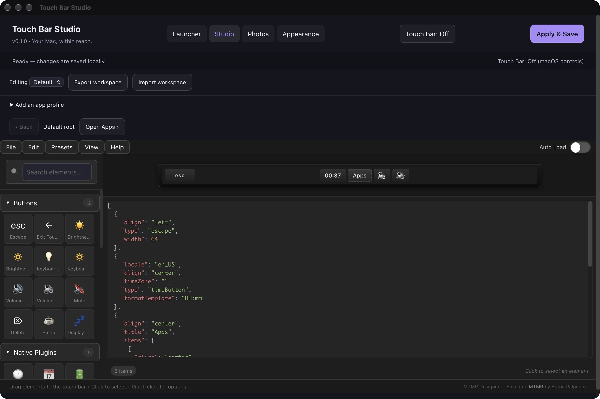
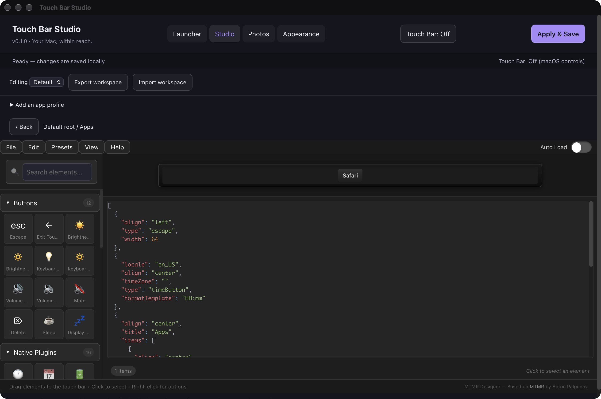
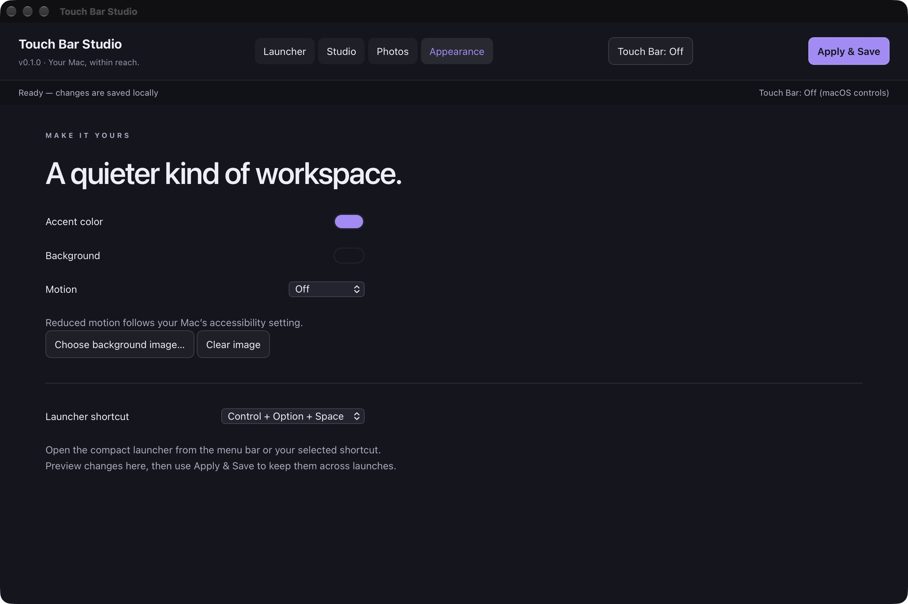

# Touch Bar Studio

A local macOS app for designing Touch Bar layouts, switching complete layouts by app, launching apps and folders, and browsing photos.

Built on [MTMR Designer](https://github.com/josmanvis/mtmr-designer) and its bundled [MTMR](https://github.com/Toxblh/MTMR) runtime. Upstream history and source notices are retained. This is an early working version.

## Current release and versioning

**[v0.1.0 — initial prerelease](https://github.com/Caylum-Hudson/touch-bar-studio/releases/tag/v0.1.0)**

The current build is `0.1.0`. Bug fixes use `0.1.1`, feature updates use `0.2.0`, and `1.0.0` marks a tested everyday-use release. See the [versioning guide](VERSIONING.md) and [changelog](CHANGELOG.md).


## Screenshots and usage

### Layout editor and on/off control



Choose the profile under **Editing**, drag or click controls in the palette, and use **Apply & Save** to activate the layout. **Touch Bar: On/Off** takes effect immediately and remembers your choice. In this screenshot the custom bar is Off, so the editor remains available while macOS controls are in use. These are app screenshots, not photographs of the physical Touch Bar.

### Nested submenus



A **Group** opens a submenu. **Open Apps** enters this example, the breadcrumb shows the current path, and **Back** returns to the parent. Add another Group inside a submenu to create another depth. The native runtime also adds Back navigation; physical touch navigation is still awaiting confirmation.

### Appearance and shortcuts



Preview accent and background colors, choose a still background image, and keep motion Off or use a subtle fade. Reduced Motion follows macOS. Choose the compact launcher shortcut here, then **Apply & Save** to retain these settings.

## Features

- Custom Touch Bar on/off switch in the app and menu bar; the choice survives restart.
- Default and app-specific replacement profiles, matched by bundle identifier.
- Recursive submenus with a Back stack, plus the original visual palette, properties, presets, JSON import/export, and undo/redo.
- Configurable app/folder launcher tiles and a compact launcher.
- App themes, still-image backgrounds, and optional reduced-motion-aware fades.
- Folder photo grid, filename/type/dimension/orientation/date filters, and a basic metadata inspector. Originals stay unchanged.
- Finder Open With support and a macOS Service declaration.

## Build from source

Requires macOS, Apple's Command Line Tools, Node.js 22 or newer, npm, and Python 3. Full Xcode is not required by the local build script.

```sh
git clone https://github.com/Caylum-Hudson/touch-bar-studio.git
cd touch-bar-studio
npm ci --ignore-scripts
./build-local.sh
```

The app is written to `../Touch Bar Studio.app`. Close a running copy before rebuilding, then open the resulting app. It is locally ad-hoc signed; it is not notarized. No prebuilt upstream DMG or Sparkle updater is used.

Use **Apply & Save** to activate layout changes. The separate **Touch Bar: On/Off** button takes effect immediately. Off returns control to macOS while keeping the launcher and editor available.

See [first-run instructions](FIRST-RUN.md) for profiles, menus, permissions, saved configuration, reset and launcher shortcuts. See [verification notes](VERIFICATION.md) for checks and remaining limitations.

## Checks

```sh
node local-build/check-state.mjs
"../Touch Bar Studio.app/Contents/MacOS/TouchBarStudio" --self-test
```

The build script runs both checks. A manual GitHub Actions build is available; it does not publish releases.

## Current limitations

Physical Touch Bar pixels, touch navigation, app-switch presentation and global shortcut delivery still need hands-on confirmation. The runtime uses upstream private Touch Bar APIs that Apple may change. Custom shell, AppleScript and swipe scripts are disabled; unknown imported fields remain available for export. A dedicated Finder Quick Action extension, resize-copy tool, recursive photo browsing and full EXIF inspection are not included.

The command-line build script is the supported build path for this version. The inherited Xcode project and older upstream instructions have not been updated for all new source files.

## Attribution and licensing

The original MTMR Designer documentation is preserved in [docs/UPSTREAM-README.md](docs/UPSTREAM-README.md). The bundled MTMR license is in [mtmr-src/LICENSE](mtmr-src/LICENSE). Preserve all file-level notices as well: some inherited bridge code has other license terms, including GPL and LaunchAtLogin notices. This repository is not a separately reviewed binary redistribution package.
