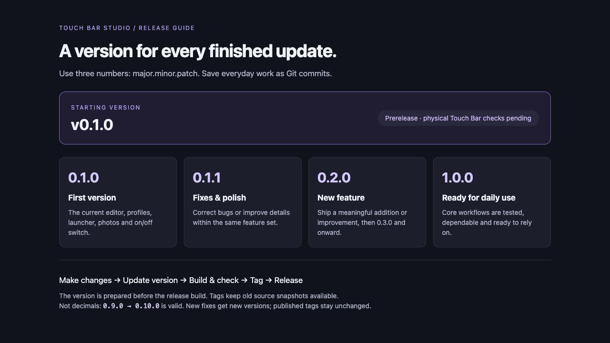

# Versioning

Touch Bar Studio uses **MAJOR.MINOR.PATCH**, starting at **0.1.0** (20 October 2026). This follows [Semantic Versioning](https://semver.org/), with a practical convention for development before 1.0.

| Example | Meaning for this app |
| --- | --- |
| `0.1.0` | First version: profiles, submenus, launcher, photos and on/off control. |
| `0.1.1` | Bug fixes or small polish without a substantial new feature. |
| `0.2.0` | A meaningful new feature or improvement. |
| `0.3.0` | The next feature update. |
| `1.0.0` | Core workflows are tested and reliable for everyday use. |
| `2.0.0` | After 1.0, a change that breaks compatibility with supported configuration or workflows. |

These are numbers, not decimals: `0.9.0` can be followed by `0.10.0`. While the first number is zero, compatibility is still developing; release notes must call out configuration changes and migration steps.

## Commits, versions, tags and releases

- **Commit:** a saved change. Not every commit gets a new app version.
- **Version:** a finished update users can identify in the app header.
- **Tag:** an immutable named source snapshot, such as `v0.1.0`.
- **GitHub release:** notes attached to that tag, explaining changes, checks and known limitations.
- **Prerelease:** a GitHub release flag for builds that still need testing. Version `0.1.0` is marked as a prerelease because physical Touch Bar checks remain outstanding. This is separate from the numeric version stored in the Mac app.

## Preparing the next release

1. Choose a version based on the table above.
2. Run `npm run version:set -- 0.1.1` (substitute the chosen version). This updates package.json, package-lock.json and the native source plist. Changing the version also increments the native build number; setting the same version again leaves it unchanged. The app header and native bundle read these values.
3. Add dated changes to CHANGELOG.md, including any known issues or configuration changes.
4. Close the app and run `./build-local.sh`. Check the native app version and any changed workflows. Update screenshots when visible behavior changes.
5. Commit the verified source, push it, and create an annotated tag matching the version.
6. Create the GitHub release from that tag. Mark it as a prerelease while important testing remains outstanding.

Once a tag or release is published, do not move it to new code. Fixes get a new version. Older releases remain available for comparison or rollback. Source archives preserve code; saved personal settings are separate, so export settings before trying a configuration change.

Only approved finished updates are released. The build workflow is manual and does not create tags or publish releases.
