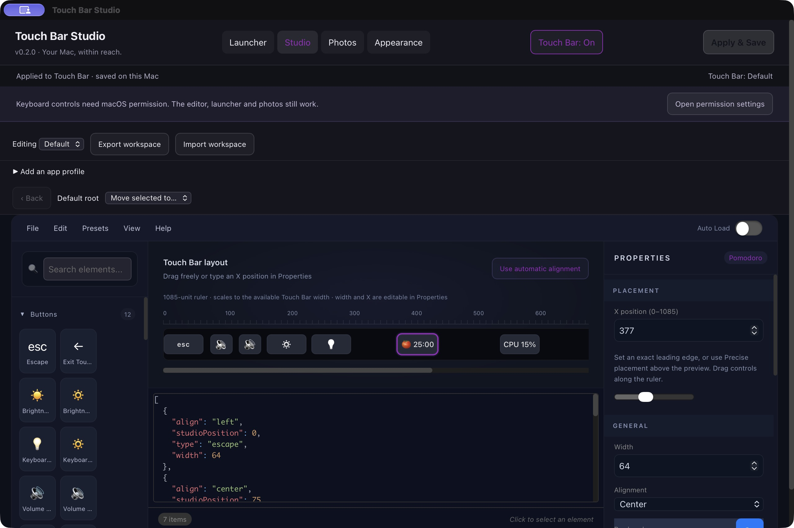
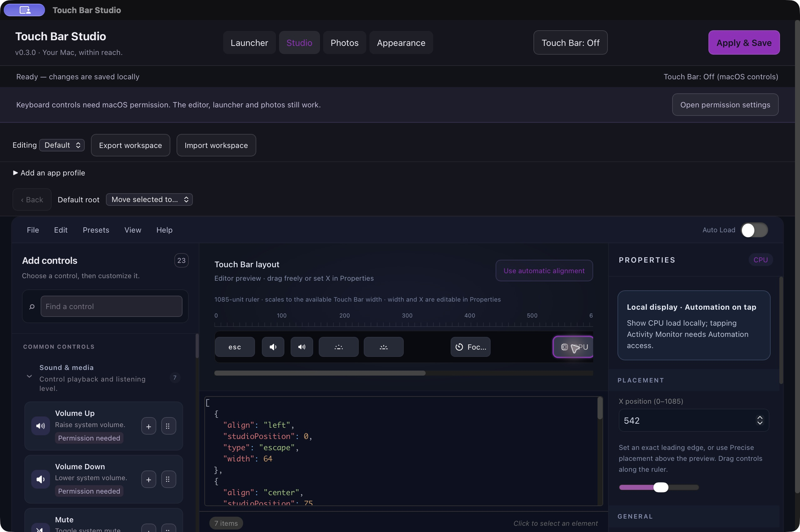
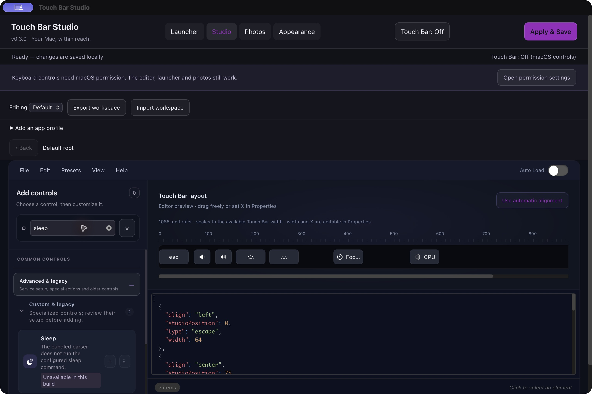

# Control library review and redesign

## 1. Choose a control — improved

The original palette used mixed emoji, clipped labels and broad categories that implied equal availability. The editor showed invented battery/CPU/weather readings. Keyboard-accessible adding was not obvious.

## 2. Add and inspect — improved, with known limits

The library now groups common tasks, uses consistent macOS symbols, keeps labels readable, and separates Add buttons from drag grips. Icon-only preview items have accessible names. The Properties panel explains capability requirements. CPU/battery/weather samples no longer masquerade as live data. Search → Date → Add produced the date format `MMM d`; the test item was then removed and the original seven-item layout saved.

Small controls can still truncate long custom text; width is editable. Precise placement uses a horizontally scrolling ruler, so its far end may be offscreen in a narrow window. Screenshots and accessibility-tree checks do not certify full assistive-technology compliance. Cmd-Z in a focused search field operates on text, so editor undo focus routing remains a follow-up.

## 3. Check availability — clearer, physical verification outstanding

Advanced search makes limits visible. Known unavailable controls cannot be newly added or dragged; existing imported entries remain exportable. Keyboard buttons require a user-granted macOS permission. Legacy system toggles and service widgets are labelled with their dependencies. The app remains Off, as selected by the user.

Catalog and native checks cover all 41 entries; 36 survive runtime filtering and five script/swipe entries are filtered. Local clock, battery, CPU, timer and volume slider initialization passed. Physical touches, device changes, external services and Automation-dependent actions were not verified. See [the runtime matrix](CONTROL-RUNTIME-AUDIT.md) and [verification record](../VERIFICATION.md).
