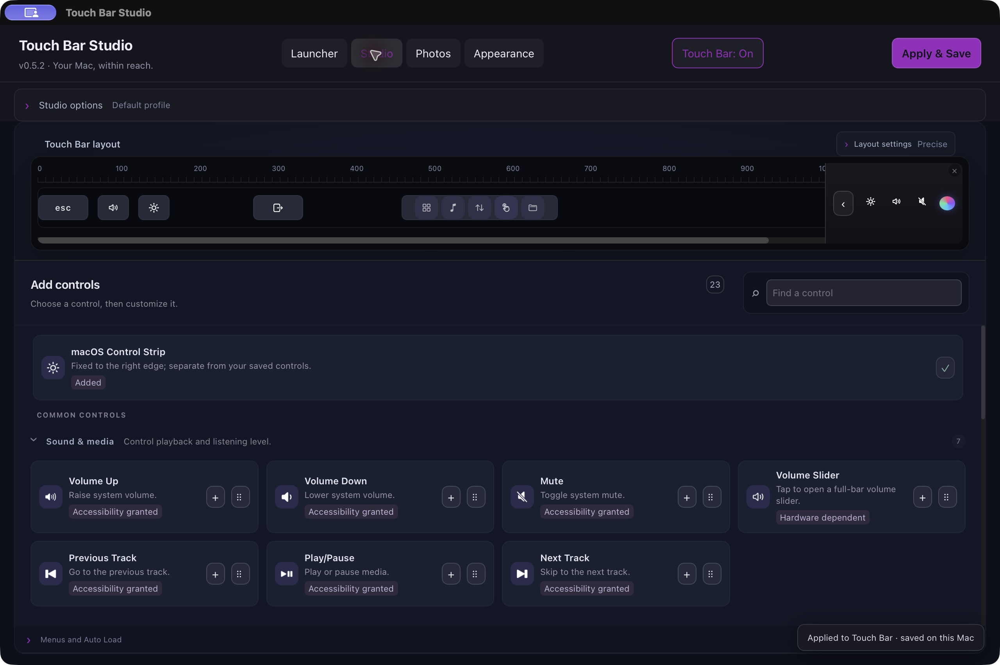
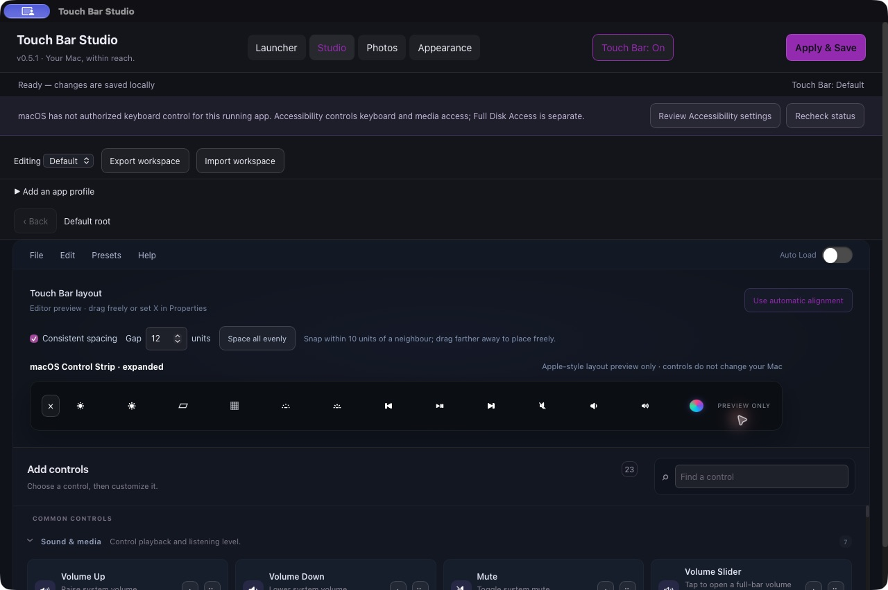

# Native Control Strip layout preview

Version **0.5.1** adds a visual preview of macOS's Control Strip when **Keep macOS Control Strip** is enabled. The compact preview appears beside the custom Touch Bar layout.

Use the arrow in the compact preview to expand it into a full-width Control Strip preview. **Collapse** returns to the same custom layout. The preview is visual only: its sample controls do not operate macOS and do not change saved controls, positions, or widths.

The frontend/native build, strict code-signature verification, JavaScript tests (8/8), scoped lint (zero errors; existing hook warnings remain), and required frontend/native checks passed. UI checks confirmed compact and expanded preview, full-width slider precedence and Back navigation, and preservation of the enabled Touch Bar layout with Keep macOS Control Strip on. Accessibility and event posting both report Granted for this app after the user-authorized reauthorization flow. Physical Touch Bar actions and system Control Strip expansion/input delivery remain unverified.

See the [verification record](../../VERIFICATION.md) for current results.
